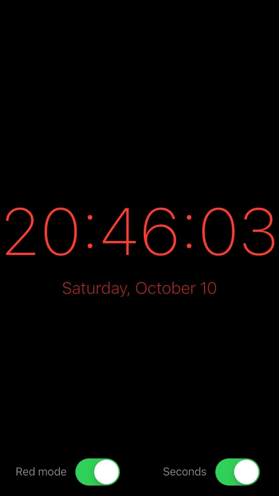
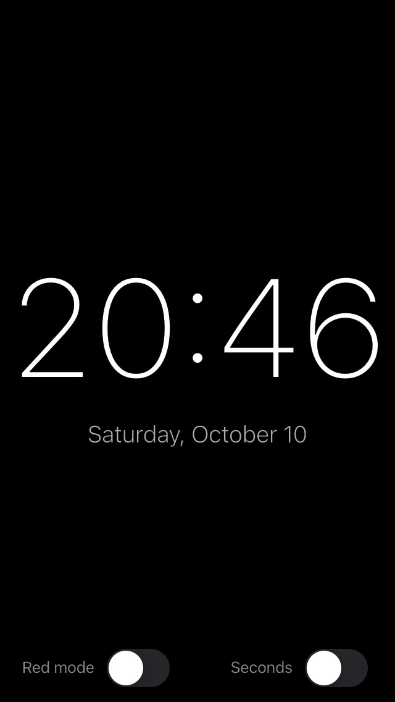
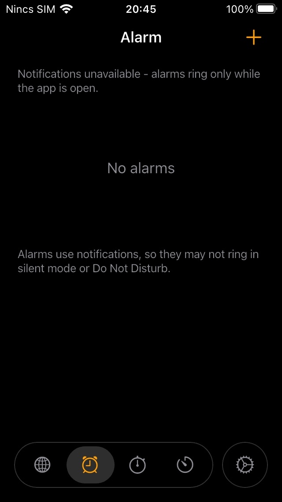
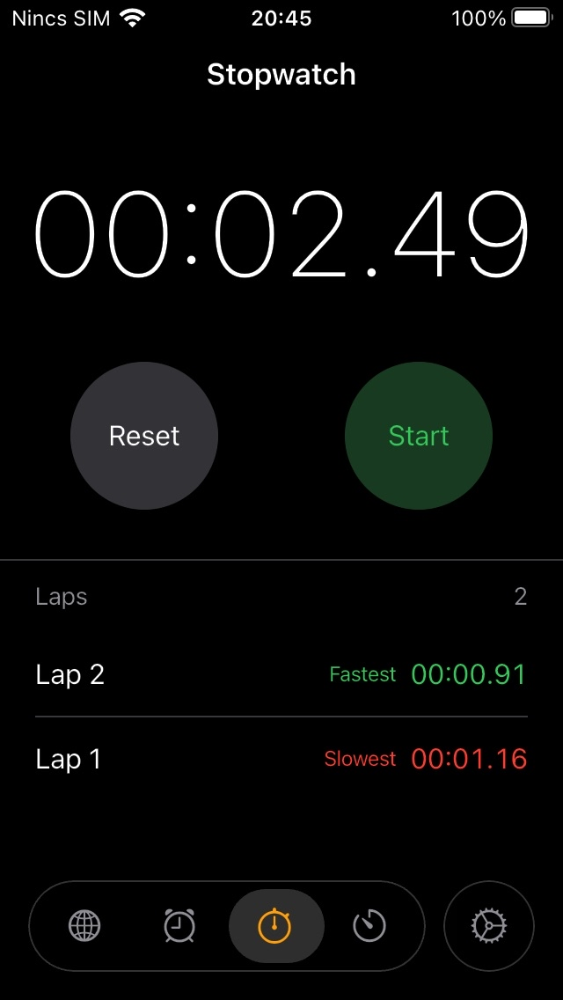
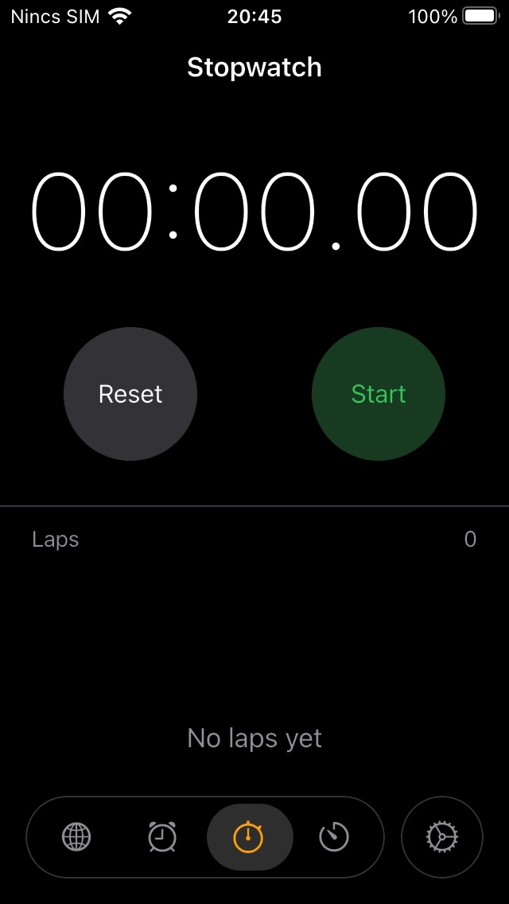
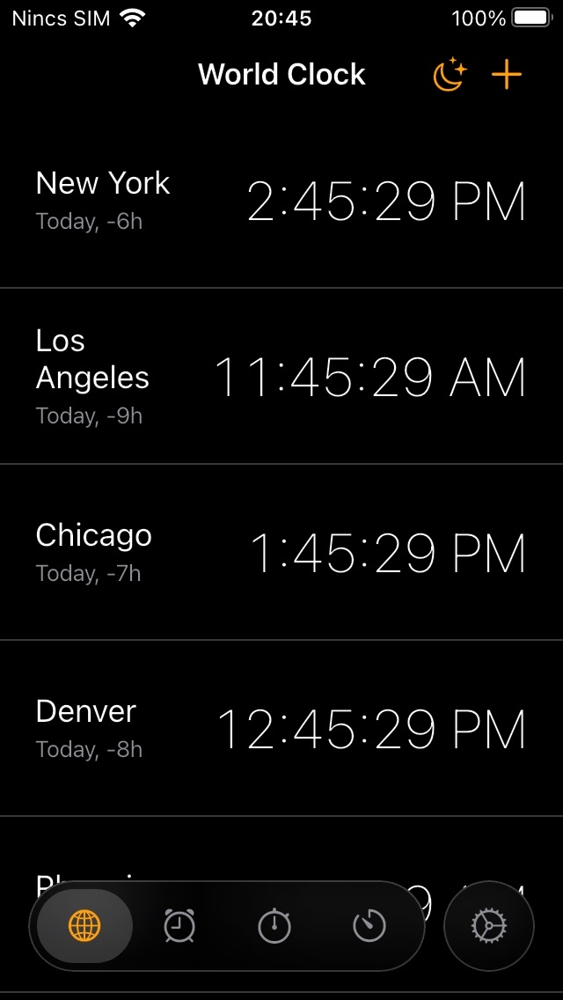
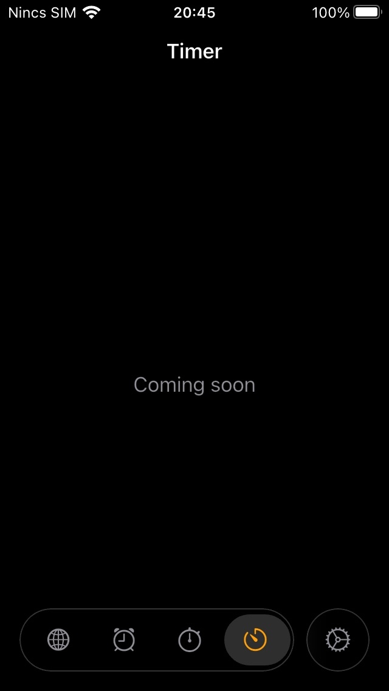
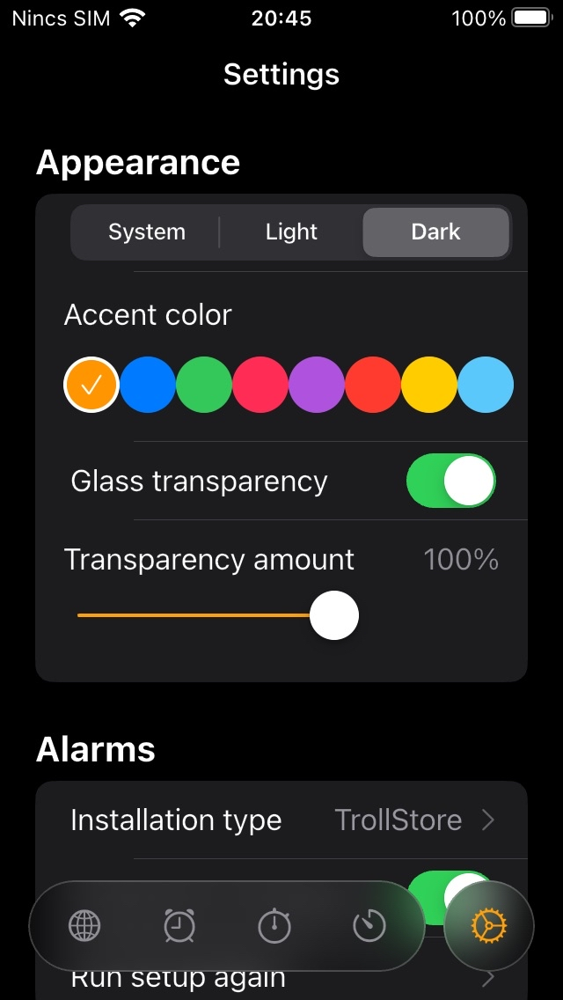

# Clock*

A lightweight Cupertino-style clock app inspired by the iOS Clock app, with
support for iOS 15 and later.

## Features

### Nightstand

Customizable full-screen clock with red mode and optional seconds.




### Alarms

Create alarms with the system notification sound. In-app ringing is available
while the app is open.



### Stopwatch

Start, stop, record laps, and compare the fastest and slowest laps.




### World Clock

See local times and day differences for cities around the world.



### Timer

The timer screen is planned.



### Personalization

Choose a theme, accent color, glass transparency, and haptic feedback.



### Add a feature and screenshot

Copy this template into the feature list, replace the description and image
path, and add the screenshot under `Docs/Screenshoots/`:

```markdown
### Feature name

One-sentence feature description.


```

## iOS 15 build

The GitHub Actions workflow builds an unsigned iOS 15 IPA and checks the Dart
code with `flutter analyze`. To run it manually, open **Actions → iOS build →
Run workflow**. When it completes, download the `ios-15-unsigned-ipa` artifact.
The IPA inside is named `Clock.ipa`.

The IPA is unsigned. Installing it through normal iOS distribution requires
signing it with an Apple developer certificate.
